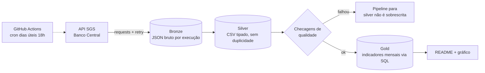

# Pipeline de Indicadores Econômicos — Banco Central do Brasil

[](../../actions/workflows/pipeline.yml)
[](../../actions/workflows/ci.yml)

Pipeline de dados de ponta a ponta que coleta **dólar, euro, meta da Selic e IPCA** da API pública do
Banco Central (SGS), organiza em camadas **bronze → silver → gold**, valida a qualidade dos dados e
publica os indicadores neste README. Roda **sozinho todo dia útil** via GitHub Actions.

## Indicadores (atualizado automaticamente)

<!-- INDICADORES:INICIO -->
_Aguardando a primeira execução do pipeline._
<!-- INDICADORES:FIM -->

## Arquitetura



| Camada | Onde fica | O que tem |
|---|---|---|
| Bronze | `data/bronze/<serie>/<data>.json` | Resposta da API sem alteração, com metadados (período, horário da extração). Permite reprocessar sem chamar a API de novo. |
| Silver | `data/silver/<serie>.csv` | Datas e valores tipados, nulos removidos, uma linha por data. Histórico completo desde 2020. |
| Gold | `data/gold/indicadores_mensais.csv` | Uma linha por mês: dólar médio e de fechamento, euro médio, Selic no fim do mês, IPCA do mês, IPCA acumulado em 12 meses e juro real aproximado. |

### Séries usadas

| Série | Código SGS | Frequência |
|---|---|---|
| Dólar americano (venda) | 1 | diária |
| Euro (venda) | 21619 | diária |
| Meta da Selic definida pelo Copom | 432 | diária |
| IPCA — variação mensal | 433 | mensal |

## Decisões de engenharia

- **Carga incremental com janela de reprocessamento.** A primeira execução busca tudo desde 2020. As
  seguintes buscam só a partir da última data conhecida menos 10 dias, para capturar correções que o
  BCB publica retroativamente. No conflito, o dado mais novo vence (`silver.mesclar`).
- **Qualidade antes de gravar.** Todas as séries são validadas (vazia, nulos, duplicidade, valores fora
  da faixa plausível, datas no futuro, dado desatualizado) **antes** de qualquer escrita na silver. Se
  uma série falha, nenhuma é gravada e o job do Actions fica vermelho.
- **Gold em SQL.** A agregação mensal é uma query SQL (`pipeline/sql/gold_indicadores_mensais.sql`)
  executada num SQLite em memória, com window functions para o fechamento do mês e para o IPCA
  acumulado em 12 meses (produto calculado como soma de logaritmos).
- **Extração resiliente.** Consultas quebradas em janelas de até 5 anos (a API limita séries diárias a
  10 anos por consulta), até 3 tentativas com espera exponencial, e `404` tratado como "sem dados no
  período" (feriados).
- **Idempotência.** Rodar duas vezes no mesmo dia gera o mesmo resultado: o arquivo bronze do dia é
  sobrescrito e a silver é deduplicada por data.
- **Testes sem internet.** Os testes usam uma API falsa (`tests/conftest.py`), incluindo um teste ponta
  a ponta que verifica carga inicial, carga incremental e que uma falha de qualidade não corrompe a silver.

## Como rodar localmente

```bash
python -m venv .venv && source .venv/bin/activate
pip install -r requirements.txt -r requirements-dev.txt

pytest                    # testes (não precisa de internet)
python -m pipeline.run    # executa o pipeline de verdade contra a API do BCB
```

## Estrutura

```
pipeline/
  config.py      séries, datas e limites
  extract.py     cliente da API SGS (janelas, retry)
  bronze.py      grava a resposta bruta
  silver.py      tipagem, limpeza, merge incremental
  quality.py     checagens de qualidade
  gold.py        executa o SQL da camada gold
  sql/           query da gold
  report.py      gráfico + atualização do README
  run.py         orquestração
tests/           testes unitários e ponta a ponta
.github/workflows/
  pipeline.yml   agendamento diário + commit dos dados
  ci.yml         testes a cada push
```

## Fonte dos dados

Banco Central do Brasil — Sistema Gerenciador de Séries Temporais (SGS), dados públicos.
O "juro real aproximado" é uma conta simplificada (Selic meta vigente descontada do IPCA dos últimos
12 meses), apenas ilustrativa.
